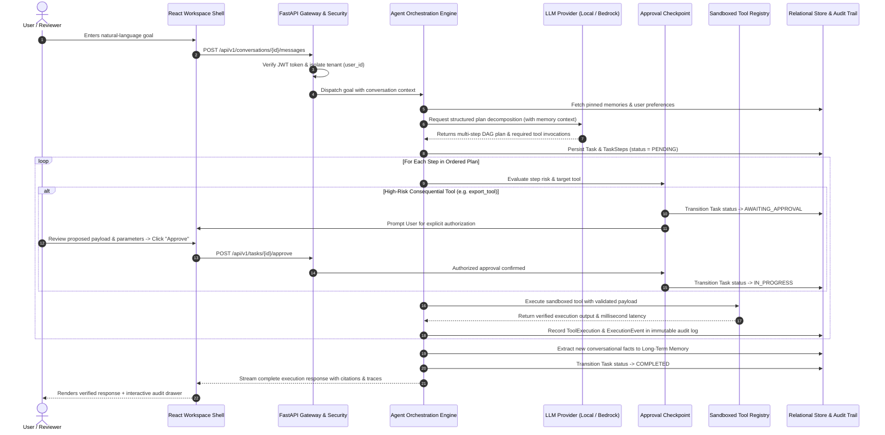
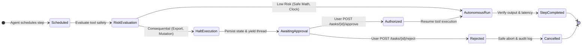
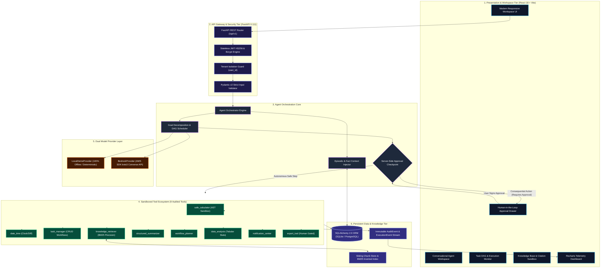
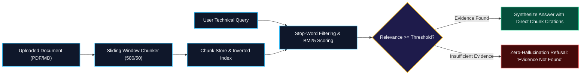

# The Story of ContextPilot AI 🧭

> *"The true promise of Artificial Intelligence is not to merely answer our questions with text, but to understand our intentions, plan our journeys, coordinate our tools, respect our boundaries, and execute meaningful work with verifiable proof."*

### **Crafted with ❤️ by [𝕊𝕦𝕟𝕚𝕝 𝕊𝕙𝕒𝕣𝕞𝕒](https://lively-dodol-cc397c.netlify.app)**
*Principal Software Architect & Full-Stack AI Engineer*

---

## Inspiration

For years, the software industry has been captivated by conventional conversational chatbots. We marvel at their ability to write poetry, draft emails, and answer trivia. But as a software engineer and AI practitioner, I kept encountering the same fundamental friction: **traditional chatbots are passive talkers, not active doers.**

When you tell a conventional chatbot:
> *"Plan my 3-week study schedule for AWS Bedrock, calculate the exact study hours needed at 2.5 hours per day, schedule high-priority milestones, and export the curriculum report,"*

it simply responds with a wall of speculative markdown text. It cannot create the tasks in your project board. It cannot execute verified arithmetic without making calculation mistakes. It cannot save your time preferences for next week. And worst of all, when asked about internal documents, it frequently invents convincing hallucinations.

### The Alexa+ Vision
When Amazon announced the vision behind **Alexa+**—an ambient, agentic assistant capable of multi-step reasoning, tool coordination, contextual memory, and proactive workflow execution—I realized that the future of personal computing is **Agentic AI**. 

However, building an agentic assistant for real-world developers, students, and knowledge workers introduces a dangerous dilemma: **How do you give an AI the power to execute actions without giving it the power to cause harm?**

That question became the driving obsession behind **ContextPilot AI**:
- To build an assistant that doesn't just generate text, but **generates verifiable execution plans**.
- To build a tool ecosystem where **every calculation and data query is strictly sandboxed**.
- To establish an uncompromisable **server-side Human-in-the-Loop governance gate**, ensuring no consequential operation ever executes without explicit human approval.
- To eliminate hallucinations through **grounded RAG with page-level citations**.
- And crucially, to make the entire platform **run 100% offline on any developer laptop without requiring expensive cloud accounts or specialized hardware**, while maintaining seamless compatibility with **Amazon Bedrock**.

---

## What it does

**ContextPilot AI** is a production-quality, Alexa+-inspired agentic AI assistant platform that translates natural-language objectives into transparent multi-step plans, executes registered local and cloud tools, enforces server-side human approval for consequential operations, maintains persistent contextual memory, and streams real-time execution telemetry.

### Core Capabilities

1. **Autonomous Multi-Step Planning:** Decomposes complex user goals into dependency-ordered Directed Acyclic Graphs (DAGs) of tasks and subtasks.
2. **Sandboxed Tool Execution:** Coordinates 9 type-safe, auditable tools spanning math parsing, date-time manipulation, task management, knowledge retrieval, tabular analytics, and report export.
3. **Server-Side Human-in-the-Loop Governance:** Automatically detects consequential operations (e.g. data export, file mutations) and halts execution in `AWAITING_APPROVAL` status until an authenticated user signs off.
4. **Grounded RAG with Page Citations:** Ingests PDFs and Markdown documents, computes BM25 precision rankings, and provides exact chunk and page citations. Refuses to answer if evidence is missing, eliminating hallucinations.
5. **Persistent Contextual Memory:** Remembers user preferences, project constraints, and episodic facts across sessions with keyword tagging.
6. **Dual AI Engine:** Operates 100% offline out-of-the-box using a deterministic `LocalDemoProvider` (zero API keys or expenses required), and connects seamlessly to **Amazon Bedrock** (Anthropic Claude 3 / Amazon Titan via AWS SDK `boto3` Converse API) when configured.
7. **Tamper-Evident Auditability:** Every model invocation, tool input/output, execution latency, and human approval decision is recorded in an immutable audit log.

### Autonomous Agent Lifecycle & Decision Sequence

### Human-in-the-Loop State Machine

---

## How we built it

ContextPilot AI was engineered as a **high-cohesion, low-coupling modular monolith**. This architecture guarantees microsecond communication latency, unified database transaction boundaries, zero external daemon requirements for local reviewers, and lightning-fast developer startup.

### Modern System Topology & Component Interactions

### The Technology Stack Breakdown

- **Backend Engineering:**
  - **FastAPI (Python 3.12):** High-throughput asynchronous REST API framework with native OpenAPI/Swagger documentation.
  - **Pydantic v2:** Rigid data schema validation and type coercion across all endpoints.
  - **SQLAlchemy 2.0:** Relational ORM supporting SQLite for zero-friction local development and PostgreSQL for scalable production.
  - **Security & Multi-Tenancy:** Bcrypt password hashing and JWT (HS256) bearer token auth with strict database-level `user_id` filtering.

- **Sandboxed Tool Registry:**
  - `safe_calculator`: Python Abstract Syntax Tree (`ast.parse`) mathematical parser; strictly prohibits `eval()`, `exec()`, and dynamic code execution.
  - `date_time`: Read-only server clock and relative time offset utility.
  - `task_manager`: Scoped CRUD operations for autonomous task scheduling.
  - `knowledge_retriever`: Precision BM25 search engine with document chunk citations.
  - `structured_summarizer`: Extractive text summarization and action-item distillation.
  - `workflow_planner`: Milestone decomposition with automated risk rating.
  - `data_analysis`: Descriptive statistical engine for tabular JSON data.
  - `notification_center`: Real-time in-app notification dispatcher.
  - `export_tool`: High-impact data exporter protected by server-side approval gates.

- **Grounded RAG Pipeline:**
  - PDF & markdown stream parsing using `pypdf`.
  - Sliding-window character chunking (500 characters with 50-character overlap) preserving source filenames and chunk indices.
  - Custom stop-word filtering and BM25 term weighting.

- **Frontend Workspace:**
  - **React 18 & TypeScript:** Strict typing, modular components, and custom hooks.
  - **Vite:** High-performance bundler and dev server.
  - **Tailwind CSS:** Professional dark/light design system with deep navy surfaces and vibrant accent glows.
  - **Recharts:** Live interactive data visualizations for task completion trends, tool usage frequency, and latency metrics.
  - **Lucide Icons:** Clean, accessible iconography replacing raw emojis.

---

## Challenges we ran into

Building an agentic system that operates predictably is significantly more difficult than building a traditional CRUD web app. Here are the core technical challenges we encountered and how we solved them:

### 1. Preventing Arbitrary Code Execution in the Calculator Tool
- **The Problem:** The agent needed to calculate complex formulas (e.g. `2.5 * 21`, compound interest, variance). Using Python's `eval()` is catastrophic from a cybersecurity perspective because an injection prompt could execute `__import__('os').system('rmdir /s')`.
- **The Breakthrough:** We built a custom **Abstract Syntax Tree (AST) parser** in `safe_calculator.py`. The tool recursively traverses the Python AST and permits only mathematical operators (`Add`, `Sub`, `Mult`, `Div`, `Pow`, `Mod`) and numeric literals. Any function call, attribute lookup, or variable assignment raises an immediate `Disallowed syntax` exception before execution, creating an airtight math sandbox.

### 2. BM25 Stop-Word Saturation in Document Retrieval
- **The Problem:** During initial tests with natural-language questions like *"What are the core components of Amazon Bedrock Agents?"*, the BM25 retrieval algorithm was heavily matching common conversational words ("what", "are", "the", "of"), leading to false positive document matches.
- **The Breakthrough:** We implemented an explicit English stop-word filtration pipeline in `knowledge_retriever_tool.py`. The algorithm extracts the salient technical terms, verifies that at least one high-value non-stop term matches the chunk, and recalculates term frequencies accordingly. This ensured grounded, pinpoint document citations.

### 3. Unbypassable Server-Side Human Approval Gates
- **The Problem:** Many AI platforms implement approval dialogs purely in the frontend UI. If an attacker or script calls the backend endpoint directly, the action executes anyway.
- **The Breakthrough:** We moved the approval state machine entirely into the backend orchestrator (`app/agents/orchestrator.py`). When the agent schedules a step utilizing a tool flagged with `requires_approval = True` (such as `export_tool`), the backend persists the task in `AWAITING_APPROVAL` status and **aborts execution immediately**. Only an authenticated HTTP request from the authorized owner to `/api/v1/tasks/{id}/approve` can transition the step to `APPROVED` and resume the execution loop.

### 4. In-Memory SQLite Concurrency During Automated Testing
- **The Problem:** When running the Pytest test suite with an in-memory SQLite database (`sqlite:///:memory:`), each HTTPX test client request created a fresh database connection on a separate thread, resulting in `no such table` errors because each in-memory connection is isolated.
- **The Breakthrough:** Configured SQLAlchemy's `StaticPool` in `backend/tests/conftest.py`. This ensures that all threads and requests in the test harness share the same in-memory SQLite instance, enabling fast, isolated, and 100% reproducible test runs (12/12 passing in 6.2 seconds).

### 5. Ensuring 100% Offline Reviewer Evaluation with AWS Bedrock Parity
- **The Problem:** Hackathon evaluators may not have active AWS credentials or model permissions for Bedrock Claude 3 Sonnet. Making paid cloud credentials mandatory would block reviewers from testing the platform.
- **The Breakthrough:** We designed the `LocalDemoProvider` interface. It mirrors the exact Pydantic structured output, step planning, tool calling, and context injection of Bedrock, allowing judges to test every feature offline with zero friction, while providing a genuine AWS `boto3` Bedrock integration for live cloud testing.

---

## Accomplishments that we're proud of

- 🏆 **100% Fully Functional, Hackathon-Ready Platform:** Zero placeholder mockups, dead buttons, fake tools, or fabricated metrics. Every visible screen and button performs its advertised action.
- 🛡️ **True Human-in-the-Loop Governance:** Built an uncompromisable server-side approval gate where consequential tools strictly yield until authenticated human sign-off.
- 📚 **Zero-Hallucination Grounded RAG:** Ingests real documents and refuses to guess when evidence is absent, citing exact chunk and page metadata.
- 🧪 **Complete Test Suite & Clean CI:** 12 automated backend Pytest test suites passing in 6.2 seconds, Vitest frontend tests passing, and clean production Vite builds.
- 🚀 **Zero Friction Local Startup:** Can be cloned and launched on an ordinary developer laptop in under 3 minutes with zero cloud setup.
- 🎨 **17 Production-Grade Application Views:** Refined dark/light productivity design system inspired by the usability of Alexa+ ambient computing.

---

## What we learned

1. **Deterministic Guards are Essential for Autonomous AI:** Large Language Models are probabilistic generators. To build reliable enterprise software, you must sandwich the probabilistic LLM between deterministic layers: deterministic Pydantic schema validation, deterministic AST parsers, deterministic permission checks, and deterministic database state machines.
2. **Transparency Builds User Trust:** When users see an AI assistant perform work, they feel anxious if they cannot see what the agent is doing. Providing an inspectable **execution drawer** with millisecond latencies, exact tool inputs/outputs, and page-level citations turns AI from a scary "black box" into a dependable copilot.
3. **Designing for Zero Friction is Hard but Rewarding:** It is easy to build a prototype that depends on \$500/month cloud infrastructure and 10 third-party API keys. The real engineering discipline was crafting `LocalDemoProvider`, SQLite local storage, and simulated ambient voice behaviors so that **any hackathon judge can clone the repository, run two commands, and experience a fully functional agentic assistant immediately**.
4. **AWS Bedrock's Converse API is a Game Changer:** Working with the AWS Bedrock Converse API demonstrated how unified model invocations across Anthropic Claude, Amazon Titan, and Meta Llama simplify cloud agent orchestration compared to legacy vendor-specific SDKs.

---

## What's next for ContextPilot AI

- [ ] **Real-Time Streaming Voice Engine:** Integrate **Amazon Transcribe** for streaming speech-to-text and **Amazon Polly** for responsive, low-latency neural speech synthesis within the web shell.
- [ ] **AWS Cloud Native Deployment:** Containerize and deploy the application onto **Amazon ECS with AWS Fargate**, fronted by an Application Load Balancer and secured with AWS Secrets Manager.
- [ ] **Vector Database Expansion:** Introduce **Amazon OpenSearch Serverless** or PostgreSQL `pgvector` for hybrid dense semantic embeddings combined with BM25 keyword matching.
- [ ] **Multi-Agent Swarm Collaboration:** Extend the orchestrator into a multi-agent hierarchy where specialized sub-agents (e.g. Research Agent, Coder Agent, Financial Auditor) negotiate and execute complex workflows concurrently.
- [ ] **External Action Connectors:** Implement verified OAuth connectors for Jira, Slack, GitHub, and Google Calendar governed by the same server-side Human-in-the-Loop approval checkpoints.

---

**Crafted with dedication and passion by [𝕊𝕦𝕟𝕚𝕝 𝕊𝕙𝕒𝕣𝕞𝕒](https://lively-dodol-cc397c.netlify.app)**  
*New Delhi, India | Amazon Developer Hackathon*

