<div align="center">

# 🧭 ContextPilot AI

### *Autonomous Multi-Step Agentic AI Assistant Platform with Human-in-the-Loop Governance & Grounded RAG*

**Amazon Developer Hackathon Submission**

---

[](https://fastapi.tiangolo.com)
[](https://react.dev)
[](https://www.typescriptlang.org)
[](https://tailwindcss.com)
[](https://aws.amazon.com/bedrock)
[](https://www.sqlalchemy.org)
[](https://docs.pydantic.dev)
[](https://www.docker.com)
[](LICENSE)

<br/>

**Crafted by [𝕊𝕦𝕟𝕚𝕝 𝕊𝕙𝕒𝕣𝕞𝕒](https://lively-dodol-cc397c.netlify.app)**

[](https://github.com/sunbyte16)
[](https://www.linkedin.com/in/sunil-kumar-bb88bb31a/)
[](https://lively-dodol-cc397c.netlify.app)

<br/>

> **"Transform natural-language goals into verifiable plans, coordinate sandboxed tools, preserve context, enforce server-side human approval for consequential operations, and verify outcomes with zero hallucination."**

<br/>

<p align="center">
  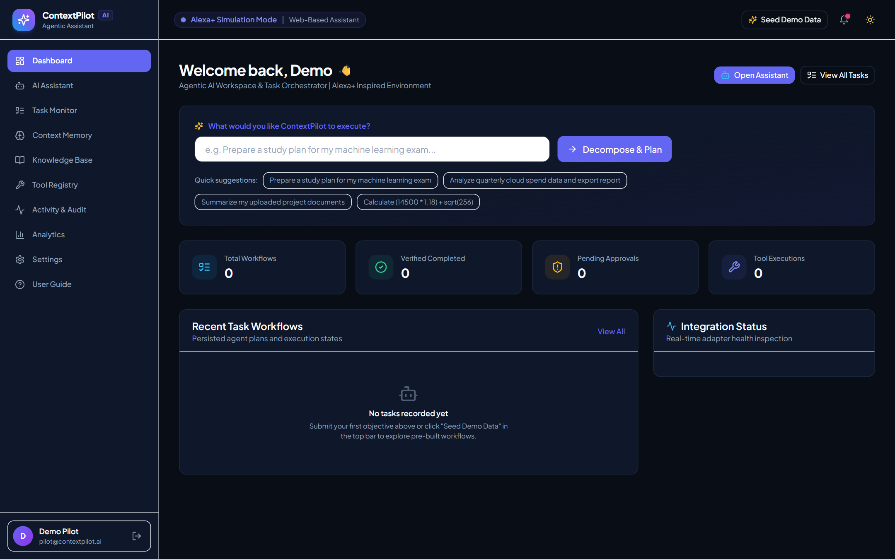
</p>

</div>

---

## 📑 Table of Contents

- [📌 Executive Summary](#-executive-summary)
- [📖 The Project Story (About.md)](About.md)
- [📸 Visual Tour & User Interface Showcase](#-visual-tour--user-interface-showcase)
- [✨ Key Architectural Innovations](#-key-architectural-innovations)
- [📐 Modern System Architecture](#-modern-system-architecture)
  - [1. End-to-End System Architecture](#1-end-to-end-system-architecture)
  - [2. Autonomous Agent Lifecycle & Decision Sequence](#2-autonomous-agent-lifecycle--decision-sequence)
  - [3. Human-in-the-Loop State Machine](#3-human-in-the-loop-state-machine)
  - [4. Grounded RAG & Citation Engine Pipeline](#4-grounded-rag--citation-engine-pipeline)
- [🛠️ Tool Ecosystem & Sandboxing](#️-tool-ecosystem--sandboxing)
- [🧰 Technology Stack](#-technology-stack)
- [🚀 Quickstart Guide](#-quickstart-guide)
  - [Prerequisites](#prerequisites)
  - [1. Backend Setup](#1-backend-setup)
  - [2. Frontend Setup](#2-frontend-setup)
- [⚡ 3-Minute Hackathon Demo Walkthrough](#-3-minute-hackathon-demo-walkthrough)
- [☁️ AWS Bedrock Integration](#️-aws-bedrock-integration)
- [🐳 Docker Deployment](#-docker-deployment)
- [🧪 Testing & Verification Evidence](#-testing--verification-evidence)
- [🔒 Security & Safety Guarantees](#-security--safety-guarantees)
- [📂 Project Directory Tree](#-project-directory-tree)
- [🤝 Contributing & Community Guidelines](#-contributing--community-guidelines)
- [👨‍💻 Author & Connect](#-author--connect)
- [📄 License & Disclaimer](#-license--disclaimer)

---

## 📌 Executive Summary

**ContextPilot AI** is an intelligent, autonomous agentic AI assistant platform built for the **Amazon Developer Hackathon**. 

Rather than functioning as a standard conversational chatbot that produces unstructured text predictions, ContextPilot AI acts as a **true execution partner**:
1. **Understands High-Level Goals:** Parses complex intent, decomposes requests into dependency-ordered Directed Acyclic Graphs (DAGs) of tasks and subtasks.
2. **Executes Sandboxed Tools:** Coordinates 9 type-safe, auditable tools spanning math parsing, date-time manipulation, knowledge retrieval, tabular analytics, and report export.
3. **Guards Consequential Operations:** Employs **server-side Human-in-the-Loop (HITL) approval gates** that automatically halt execution when sensitive operations (e.g. data export, file mutations) are detected.
4. **Remembers Long-Term Context:** Maintains persistent user preferences, past constraints, and episodic memory across sessions.
5. **Eliminates Hallucinations:** Implements Grounded Retrieval-Augmented Generation (RAG) with exact document chunk citations. If evidence is missing, the system explicitly refuses to guess.
6. **Dual AI Engine:** Runs **100% offline out-of-the-box** using a deterministic `LocalDemoProvider` (zero API keys or costs required), and connects seamlessly to **Amazon Bedrock** (Anthropic Claude 3 / Amazon Titan via AWS SDK `boto3` Converse API) when cloud credentials are configured.

> [!NOTE]
> **Hackathon Simulation Disclosure:**  
> ContextPilot AI is designed as an **Alexa+-inspired simulated web application**. It runs natively on standard development laptops without requiring physical Amazon Echo, Fire TV, Bee wearable, or Ring devices. Audio and conversational interactions are simulated within the web UI.

> [!TIP]
> **📖 Read the Project Story:**  
> Discover what inspired ContextPilot AI, key architectural learnings, the engineering journey, and technical breakthroughs in [**About.md**](About.md).

---

## 📸 Visual Tour & User Interface Showcase

Experience the production polish and design system of ContextPilot AI across its complete suite of **23 application views, modals, telemetry dashboards, and interactive states**:

### 🧭 Core Platform & Mission Control

<details open>
<summary><b>1. Mission Control & Operational Dashboard (<code>images/07_dashboard_overview.png</code>)</b></summary>
<br/>

The executive workspace command center providing real-time pipeline telemetry, quick action launchers, active task metrics, and environment status.

<p align="center">
  
</p>
</details>

<br/>

<details open>
<summary><b>2. Conversational Agent & Multi-Step Planner (<code>images/08_assistant_chat.png</code>)</b></summary>
<br/>

Conversational workspace where high-level natural language objectives are analyzed, decomposed into DAG execution steps, and displayed with intent badges and citations.

<p align="center">
  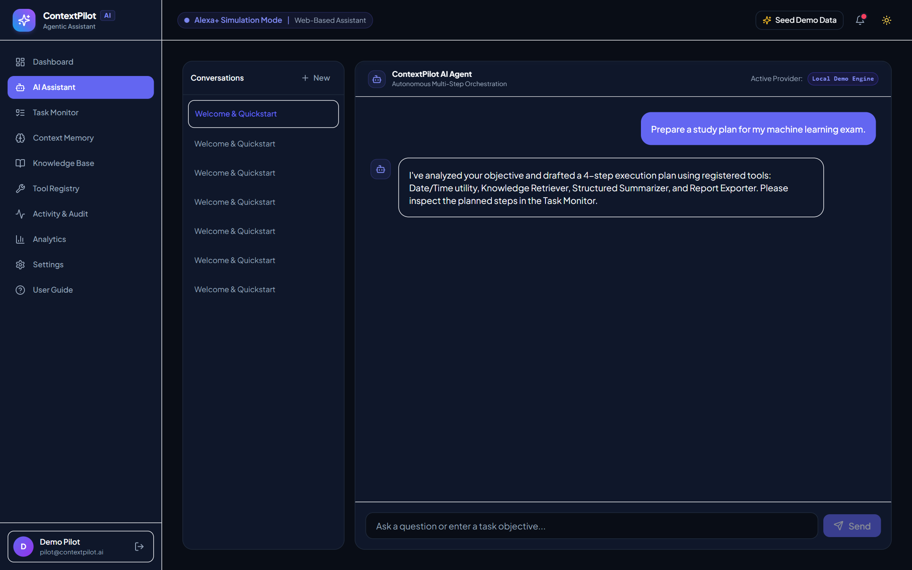
</p>
</details>

<br/>

<details open>
<summary><b>3. Live Assistant Multi-Step Execution & Trace (<code>images/09_assistant_active_execution.png</code>)</b></summary>
<br/>

Active conversation stream showing multi-step plan synthesis, tool coordination, and transparent verification traces.

<p align="center">
  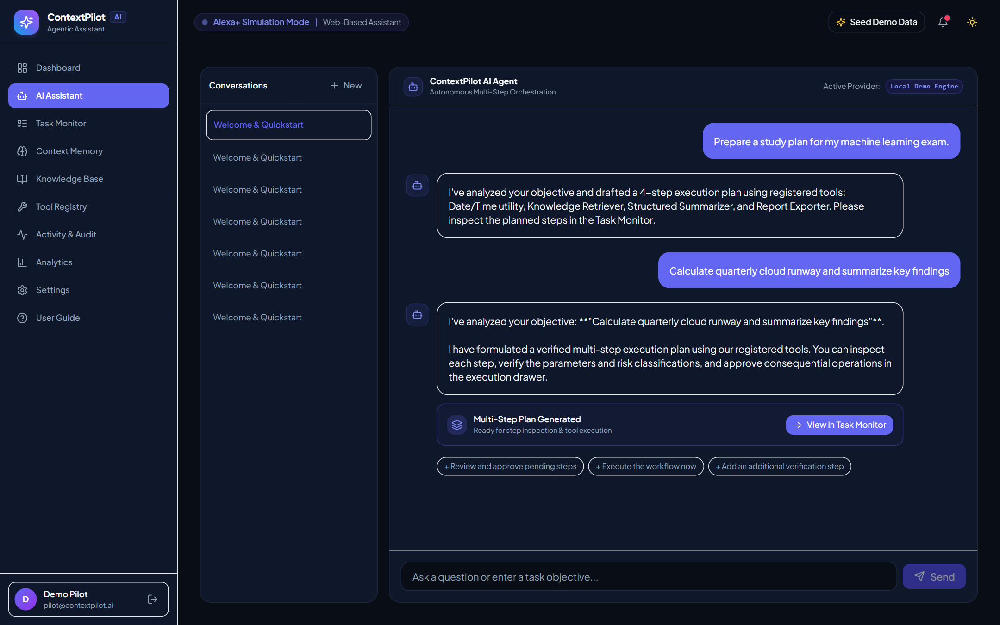
</p>
</details>

<br/>

<details open>
<summary><b>4. Autonomous Task & Plan Monitor (<code>images/10_task_workflows.png</code>)</b></summary>
<br/>

Real-time task tracking interface visualizing scheduled milestones, execution priority, percentage completion, and risk classifications.

<p align="center">
  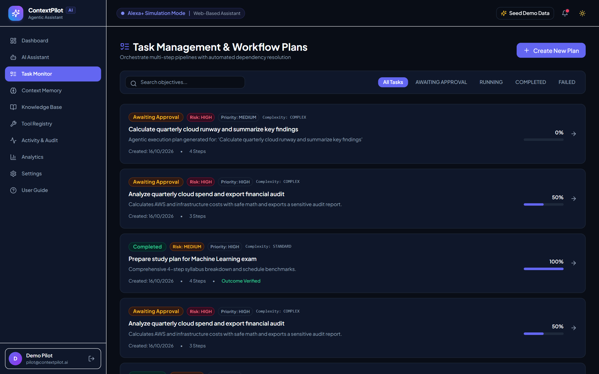
</p>
</details>

<br/>

<details open>
<summary><b>5. Human-in-the-Loop Server-Side Approval Gate (<code>images/11_task_detail_approval.png</code>)</b></summary>
<br/>

When consequential operations (e.g. `export_tool`) are detected, execution strictly yields into `AWAITING_APPROVAL`. Users review exact proposed parameters and risk levels before authorizing execution.

<p align="center">
  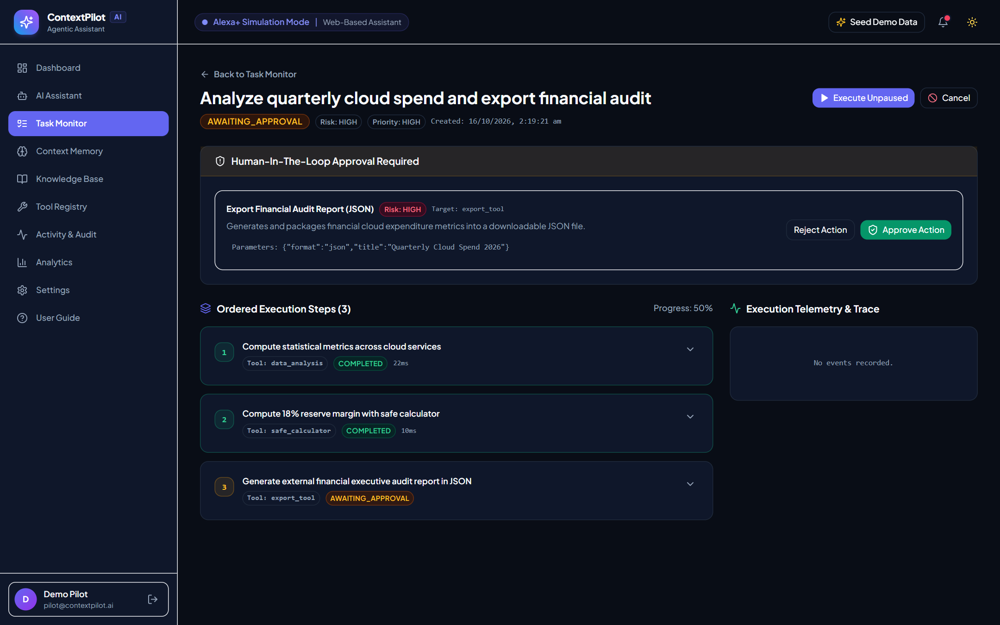
</p>
</details>

<br/>

### 🧠 Intelligence, Tools & Grounded RAG

<details>
<summary><b>6. Knowledge Base & Grounded RAG Overview (<code>images/12_knowledge_rag.png</code>)</b></summary>
<br/>

Document ingestion manager showing indexed PDFs and Markdown documents with chunk counts and storage metrics.

<p align="center">
  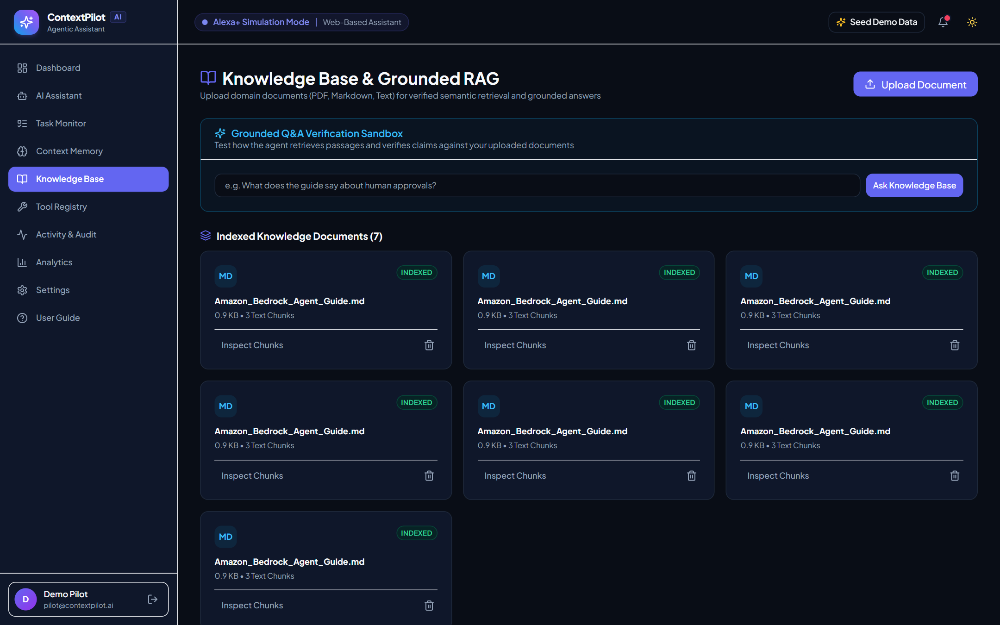
</p>
</details>

<br/>

<details>
<summary><b>7. Grounded Q&A Verification with Citations (<code>images/13_knowledge_rag_search.png</code>)</b></summary>
<br/>

Grounded search sandbox where questions are answered strictly from verified document chunks with source filenames and page citations. Refuses to guess if evidence is insufficient.

<p align="center">
  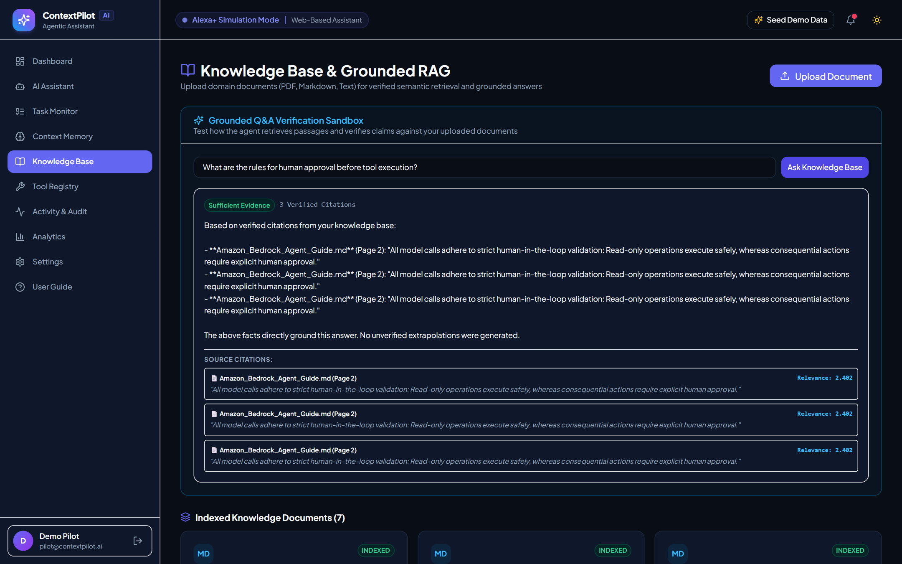
</p>
</details>

<br/>

<details>
<summary><b>8. Persistent Contextual Memory Hub (<code>images/14_memory_hub.png</code>)</b></summary>
<br/>

Curated user memory system tracking user preferences, project constraints, and episodic facts with category badges (`FACT`, `PREFERENCE`, `PROJECT CONTEXT`, `NOTE`).

<p align="center">
  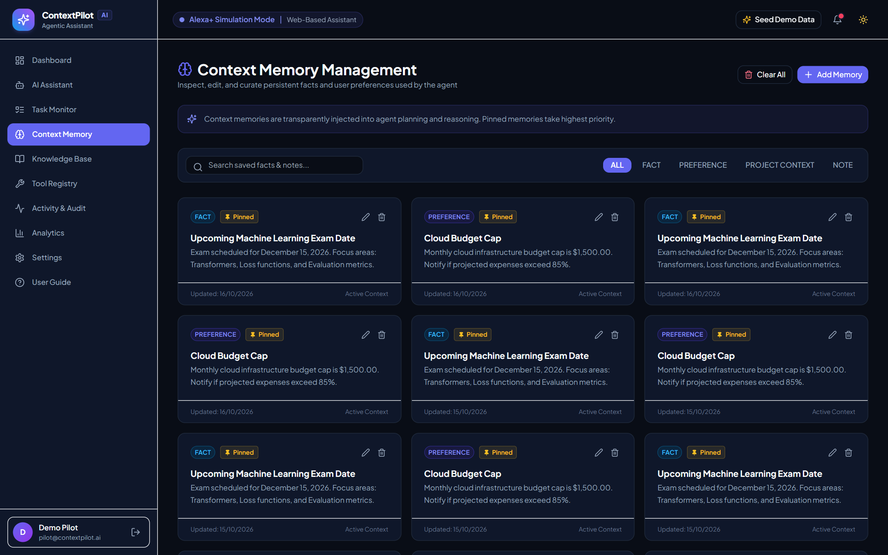
</p>
</details>

<br/>

<details>
<summary><b>9. Sandboxed Tool Safety Registry (<code>images/15_tool_registry.png</code>)</b></summary>
<br/>

Comprehensive registry for all 9 registered execution dispatchers, enforcing strict input/output schemas and AST security boundaries.

<p align="center">
  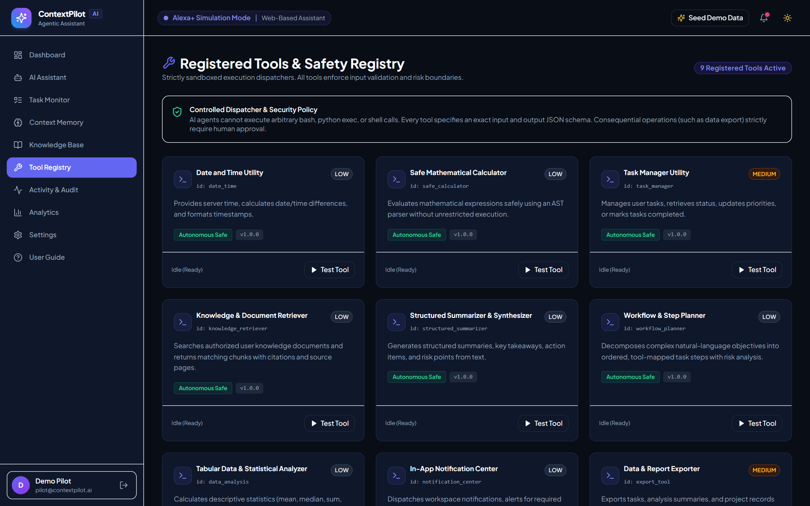
</p>
</details>

<br/>

<details>
<summary><b>10. Interactive Tool Execution Testbench (<code>images/16_tool_testbench_modal.png</code>)</b></summary>
<br/>

Live modal testbench allowing interactive parameter testing, sandboxed invocation, and real-time JSON result inspection.

<p align="center">
  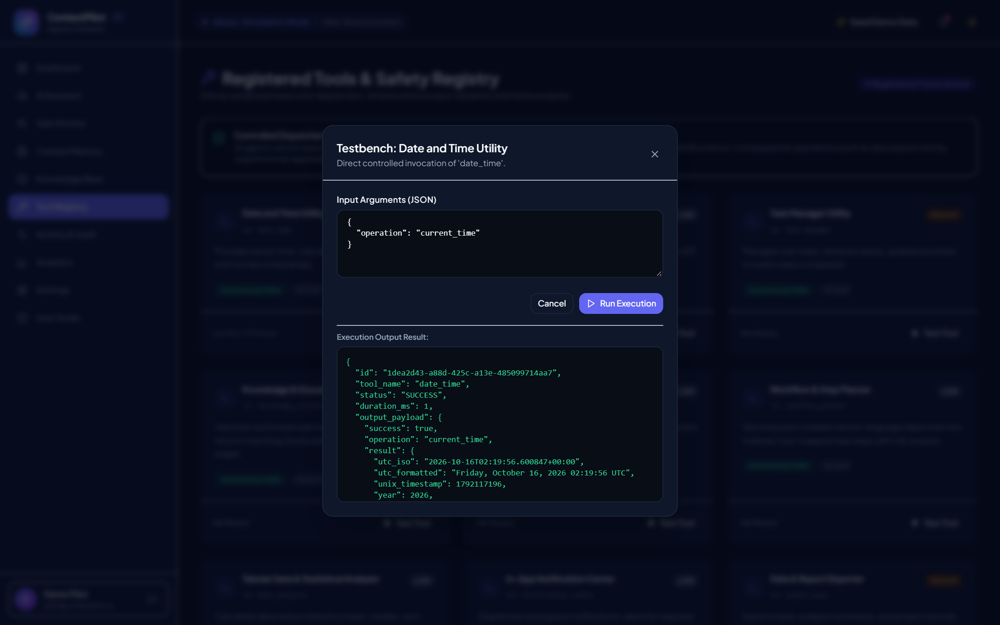
</p>
</details>

<br/>

### 📊 Telemetry, Security & Governance

<details>
<summary><b>11. Immutable Activity & Audit Trail (<code>images/17_activity_audit.png</code>)</b></summary>
<br/>

Tamper-evident audit log recording every user authentication, task transition, tool invocation, and human approval decision.

<p align="center">
  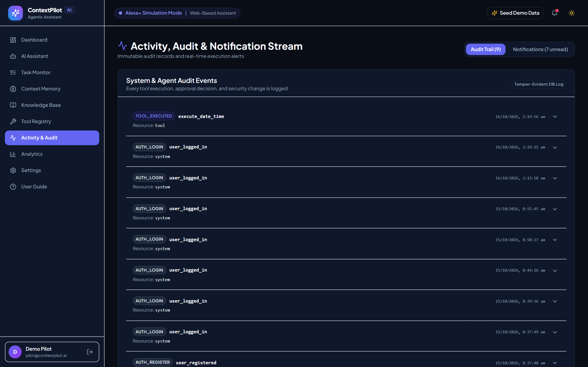
</p>
</details>

<br/>

<details>
<summary><b>12. Real-Time System Notification Center (<code>images/18_activity_notifications.png</code>)</b></summary>
<br/>

Centralized notification inbox organizing approval requests, execution alerts, and system health status.

<p align="center">
  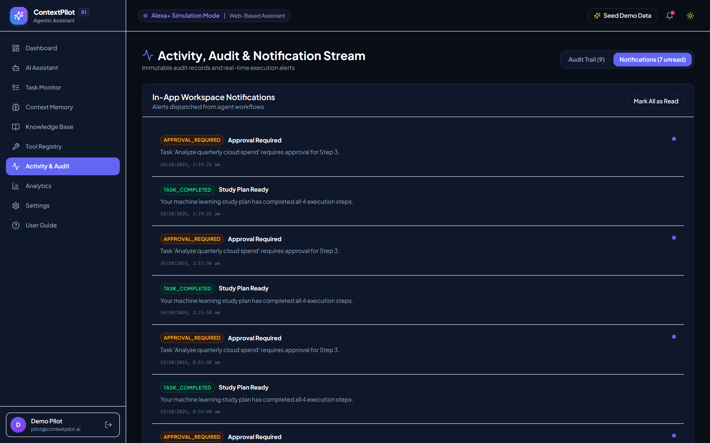
</p>
</details>

<br/>

<details>
<summary><b>13. Real-Time Telemetry & Recharts Analytics (<code>images/19_analytics_telemetry.png</code>)</b></summary>
<br/>

Live execution metrics computed directly from database records, including 7-day completion trends, tool invocation frequency, and pipeline status breakdowns.

<p align="center">
  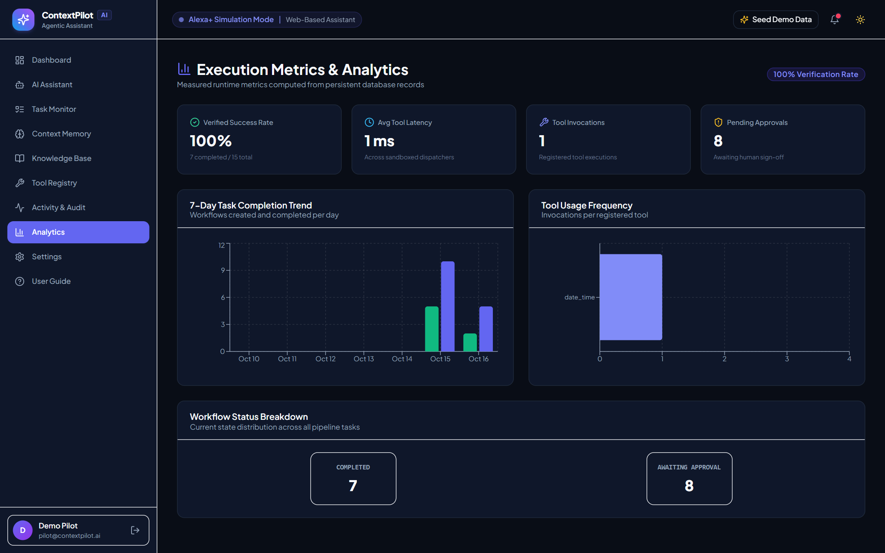
</p>
</details>

<br/>

### ⚙️ Configuration & Enterprise Controls

<details>
<summary><b>14. Settings: User Profile & Tenant Info (<code>images/20_settings_profile.png</code>)</b></summary>
<br/>

User account preferences, profile credentials, and workspace tenant isolation configuration.

<p align="center">
  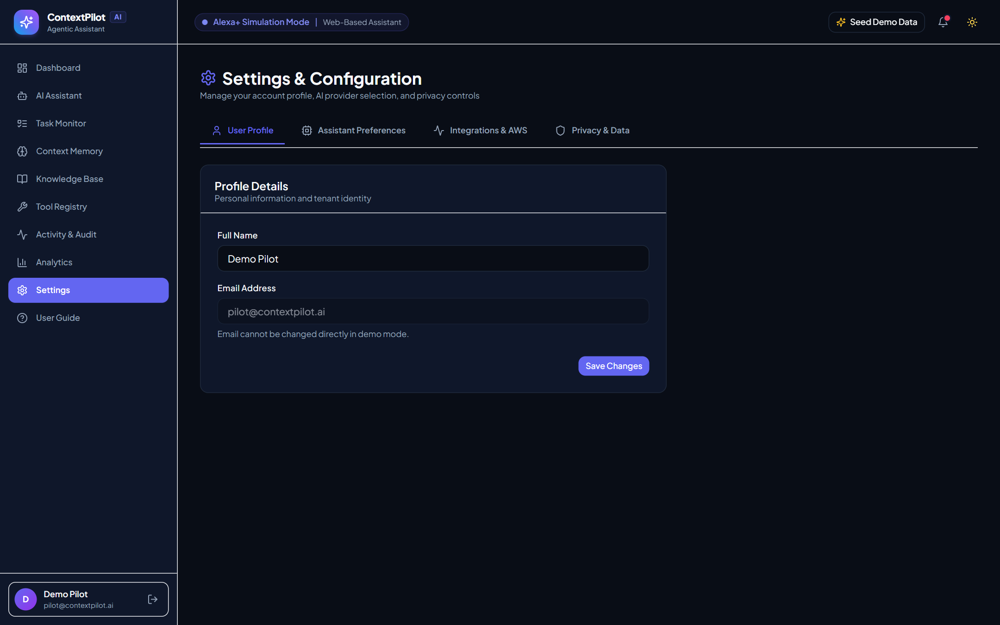
</p>
</details>

<br/>

<details>
<summary><b>15. Settings: Assistant Preferences & Autonomy Gates (<code>images/21_settings_assistant.png</code>)</b></summary>
<br/>

Granular controls over agent execution autonomy, auto-approval thresholds for low-risk actions, and default planning strategies.

<p align="center">
  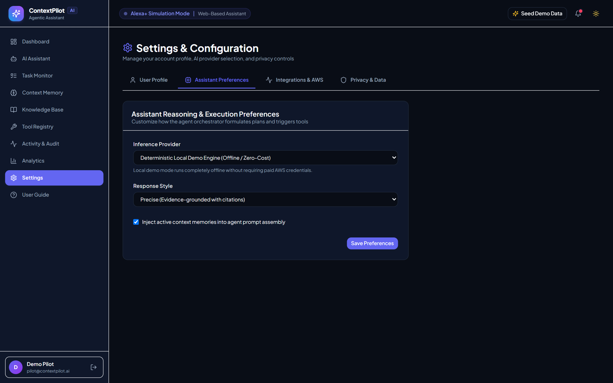
</p>
</details>

<br/>

<details>
<summary><b>16. Settings: Model Providers & AWS Bedrock (<code>images/22_settings_provider.png</code>)</b></summary>
<br/>

Seamlessly toggle between deterministic offline `LocalDemoProvider` and live AWS Bedrock `BedrockProvider` with interactive connectivity testing.

<p align="center">
  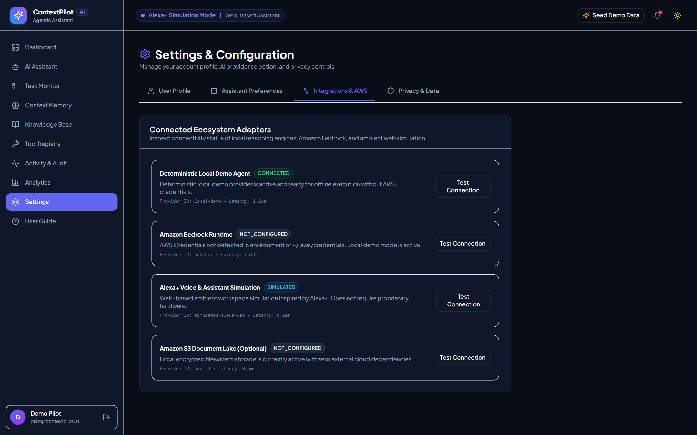
</p>
</details>

<br/>

<details>
<summary><b>17. Comprehensive Documentation & User Guide (<code>images/23_help_guide.png</code>)</b></summary>
<br/>

In-app documentation, architectural guides, security policies, and keyboard shortcuts.

<p align="center">
  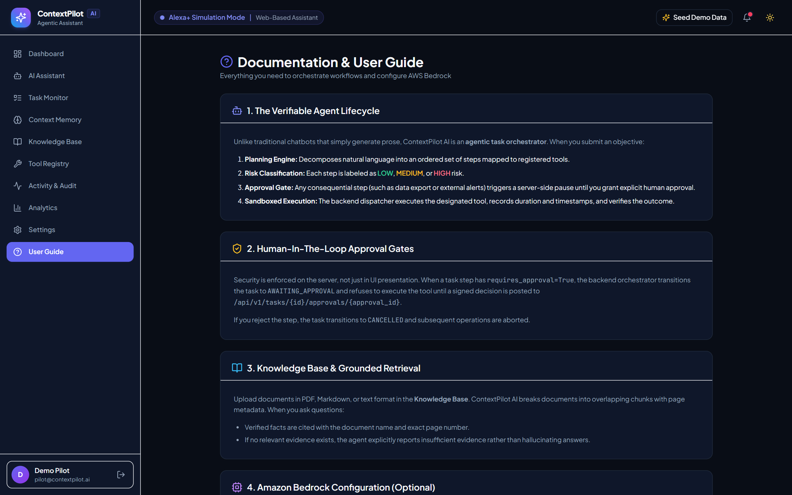
</p>
</details>

<br/>

### 🌐 Public Portal & Onboarding Experience

<details>
<summary><b>18. Product Landing Page Hero (<code>images/01_landing_page.png</code>)</b></summary>
<br/>

Polished product landing page explaining the verifiable agentic lifecycle, features, and hackathon scope.

<p align="center">
  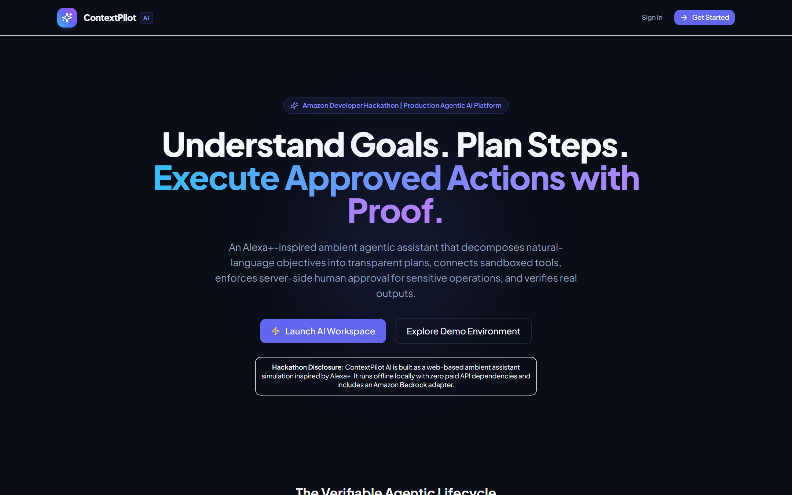
</p>
</details>

<br/>

<details>
<summary><b>19. Product Landing Page Features & Architecture (<code>images/02_landing_features.png</code>)</b></summary>
<br/>

In-depth feature breakdown, multi-step agent flow visualizer, and technology architecture highlights.

<p align="center">
  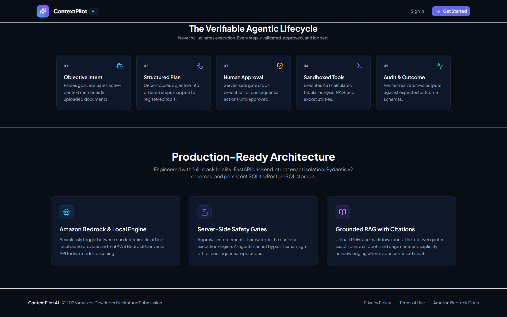
</p>
</details>

<br/>

<details>
<summary><b>20. User Authentication & 1-Click Demo Login (<code>images/03_login_page.png</code>)</b></summary>
<br/>

Secure sign-in with instant demo credential autofill for immediate evaluation by hackathon reviewers.

<p align="center">
  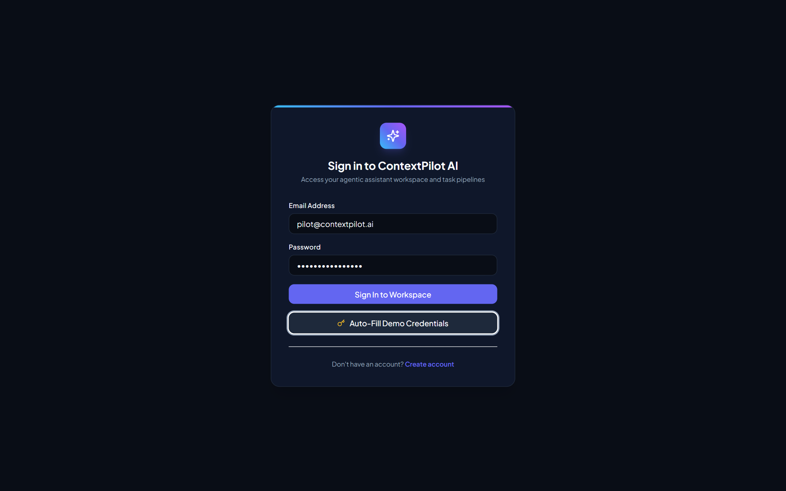
</p>
</details>

<br/>

<details>
<summary><b>21. Account Registration (<code>images/04_register_page.png</code>)</b></summary>
<br/>

User registration screen with password complexity validation and tenant initialization.

<p align="center">
  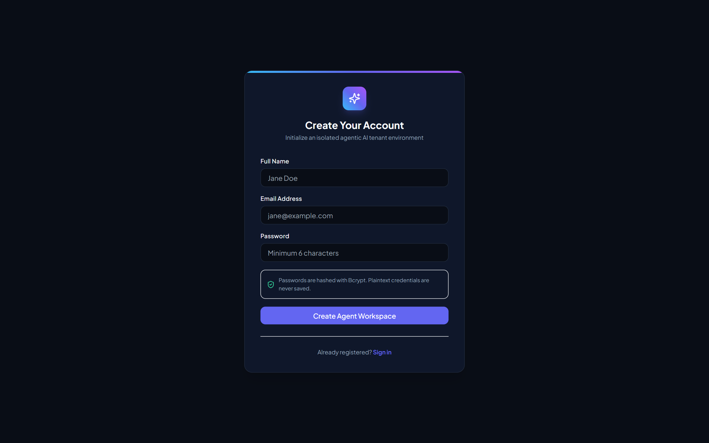
</p>
</details>

<br/>

<details>
<summary><b>22. Data Privacy & Sovereignty Policy (<code>images/05_privacy_policy.png</code>)</b></summary>
<br/>

Detailed explanation of local data persistence, sandboxed execution safety, and zero telemetry sharing.

<p align="center">
  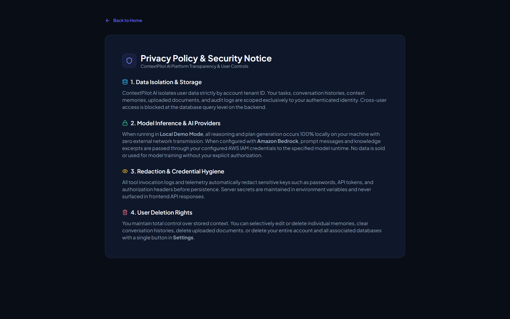
</p>
</details>

<br/>

<details>
<summary><b>23. Terms of Service & Simulation Disclosure (<code>images/06_terms_of_service.png</code>)</b></summary>
<br/>

Comprehensive terms of service with explicit Alexa+-inspired simulation disclosures.

<p align="center">
  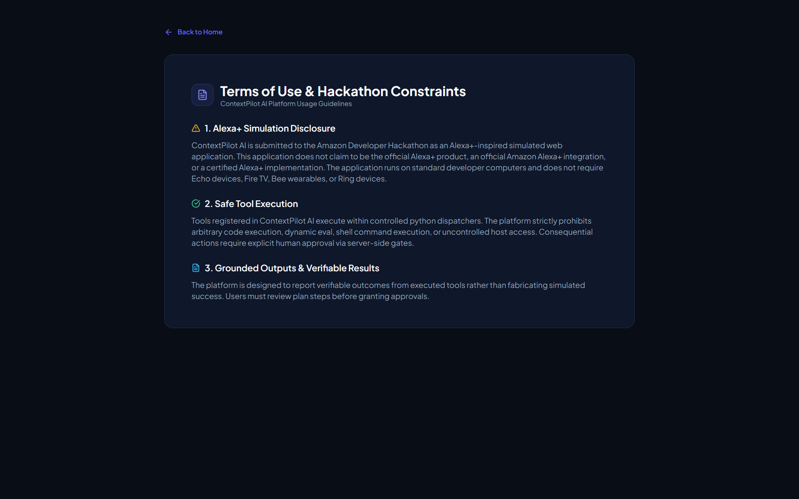
</p>
</details>

---

## ✨ Key Architectural Innovations

```
  ┌────────────────────────────────────────────────────────────────────────┐
  │                           ContextPilot AI                              │
  ├────────────────────────────────────────────────────────────────────────┤
  │  🎯 Goal Decomposition       ⚡ Sandboxed Tool Execution              │
  │  🛡️ Server-Side HITL Gates   🧠 Persistent Episodic Memory            │
  │  📚 Grounded RAG Citations   📊 Real-Time Execution Telemetry         │
  │  🔌 Dual Engine (Offline/AWS)🔒 Multi-Tenant Data Isolation           │
  └────────────────────────────────────────────────────────────────────────┘
```

| Capability | Engineering Implementation | Hackathon Advantage |
|---|---|---|
| **Autonomous Planning** | Dynamic goal decomposition into multi-step execution graphs. | Decomposes high-level intent into deterministic tool steps. |
| **Human-in-the-Loop** | Server-side `AWAITING_APPROVAL` barrier blocks execution until signed approval. | Eliminates rogue agent execution and unauthorized data mutation. |
| **Sandboxed AST Tools** | Python Abstract Syntax Tree (`ast.parse`) mathematical parser; zero host shell. | Math evaluation without arbitrary code execution vulnerabilities. |
| **Grounded RAG** | `pypdf` text stream parser + Sliding chunk indexer + BM25 precision matching. | Page-level verifiable citations; zero hallucination honesty. |
| **Contextual Memory** | Tagged key-value memory store persisted in relational database per user. | Learns user constraints and applies them across conversations. |
| **Dual AI Provider** | Abstracted `BaseLLMProvider` with `LocalDemoProvider` & `BedrockProvider`. | Guaranteed zero-friction local reviewer evaluation + genuine AWS power. |
| **Audit & Telemetry** | Append-only `AuditEvent` and `ExecutionEvent` streams with millisecond latency. | Full transparency into agent reasoning and tool performance. |

---

## 📐 Modern System Architecture

### 1. End-to-End System Architecture

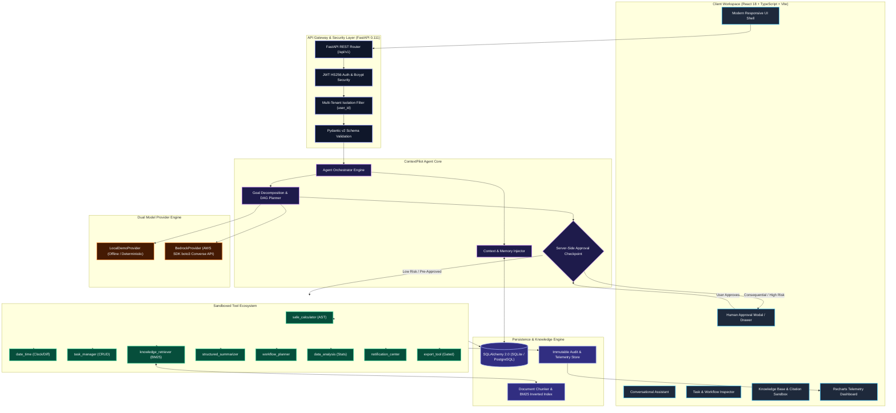

---

### 2. Autonomous Agent Lifecycle & Decision Sequence

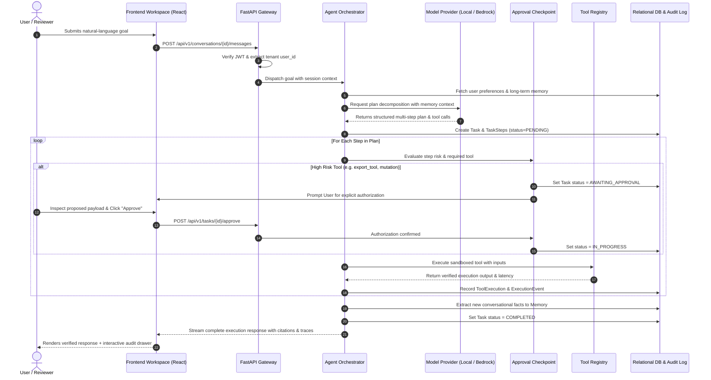

---

### 3. Human-in-the-Loop State Machine

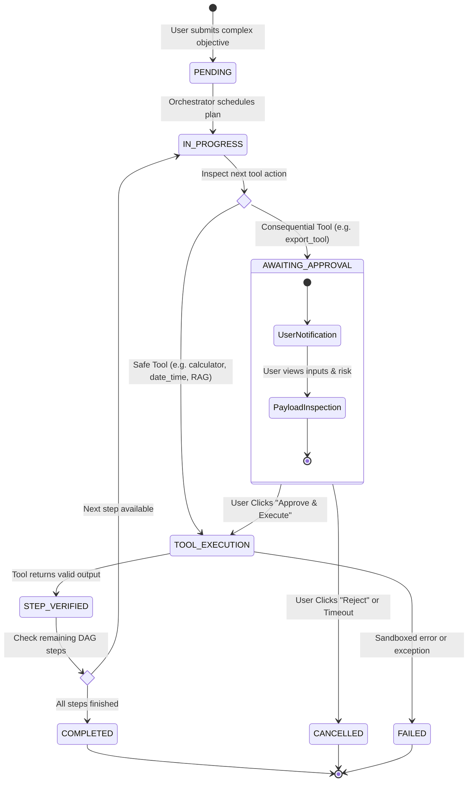

---

### 4. Grounded RAG & Citation Engine Pipeline

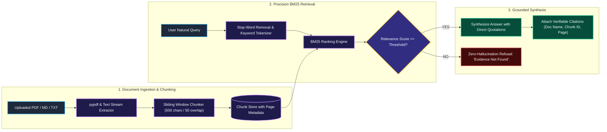

---

## 🛠️ Tool Ecosystem & Sandboxing

ContextPilot AI includes **9 production-grade, sandboxed tools** registered in `app/tools/registry.py`:

| Tool Identifier | Module | Description | Sandboxing & Safety Guarantee |
|---|---|---|---|
| `safe_calculator` | `safe_calculator.py` | Evaluates arithmetic, percentages, averages, and basic math. | **Python AST parsing (`ast.parse`)**. Zero `eval()`, zero `exec()`, forbidden imports or attribute access. |
| `date_time` | `date_time_tool.py` | Current server time, timezone offsets, and date calculations. | Read-only server clock access. Cannot modify system time. |
| `task_manager` | `task_manager_tool.py` | Autonomous task and subtask creation, status updates, priority tracking. | Scoped strictly to the authenticated `user_id`. Cannot access other tenants. |
| `knowledge_retriever` | `knowledge_retriever_tool.py` | BM25 keyword matching across indexed user documents with page numbers. | Queries isolated document chunks with non-stop word validation. |
| `structured_summarizer` | `structured_summarizer_tool.py` | Extracts concise summaries, key takeaways, and action items from text. | Purely functional text processing. No external network access. |
| `workflow_planner` | `workflow_planner_tool.py` | Decomposes goals into dependency-aware milestones with risk classification. | Deterministic structured schema generation with Pydantic validation. |
| `data_analysis` | `data_analysis_tool.py` | Computes statistical summaries, mean, median, min, max, standard deviation. | Safe numeric computation over tabular JSON arrays. |
| `notification_center` | `notification_tool.py` | Dispatches in-app alerts and notifications to the user interface. | Internal database record creation. No external SMS or spam egress. |
| `export_tool` | `export_tool.py` | Generates structured Markdown, JSON, or CSV data exports. | **Mandatory Human Approval Gate**. Halts execution until explicit user sign-off. |

---

## 🧰 Technology Stack

```
Frontend:   [React 18] ── [TypeScript 5.5] ── [Vite] ── [Tailwind CSS] ── [Recharts] ── [Lucide]
               │
REST API:      ▼ (Bearer JWT Auth)
Backend:    [FastAPI 0.111] ── [Pydantic v2] ── [SQLAlchemy 2.0] ── [pypdf] ── [AST Sandbox]
               │
Storage:       ▼
Database:   [SQLite 3 (Local WAL Mode)]  /  [PostgreSQL 16 (Docker Production)]
               │
AI Engine:     ▼
Providers:  [LocalDemoProvider (Deterministic)]  ◄──►  [Amazon Bedrock (boto3 Converse API)]
```

---

## 🚀 Quickstart Guide

Get ContextPilot AI running locally in **less than 3 minutes** with zero cloud setup.

### Prerequisites
- **Python 3.11** or **3.12**
- **Node.js 18+** (Node 20, 22, or 24 recommended)
- **Git**

### 1. Backend Setup

```bash
# Clone the repository
git clone https://github.com/sunbyte16/ContextPilot-AI.git
cd ContextPilot-AI/backend

# Create and activate virtual environment
# On Windows (PowerShell):
python -m venv .venv
.\.venv\Scripts\Activate.ps1

# On Linux / macOS:
python3 -m venv .venv
source .venv/bin/activate

# Install backend dependencies
pip install -r requirements.txt

# Start the FastAPI backend server
uvicorn app.main:app --host 127.0.0.1 --port 8000 --reload
```

- **Backend API:** [http://127.0.0.1:8000](http://127.0.0.1:8000)
- **Interactive Swagger Docs:** [http://127.0.0.1:8000/docs](http://127.0.0.1:8000/docs)
- **System Health Endpoint:** [http://127.0.0.1:8000/health](http://127.0.0.1:8000/health)

---

### 2. Frontend Setup

In a new terminal window:

```bash
cd ContextPilot-AI/frontend

# Install frontend packages
npm install

# Start Vite development server
npm run dev
```

- **Frontend Application:** [http://localhost:5173](http://localhost:5173)

---

## ⚡ 3-Minute Hackathon Demo Walkthrough

Follow this step-by-step evaluator journey to test all core agentic capabilities:

1. **One-Click Demo Sign In:**
   - Navigate to [http://localhost:5173/login](http://localhost:5173/login).
   - Click the **"Fill Demo Account"** button (`demo@contextpilot.ai` / `DemoPass123!`).
   - Click **"Sign In"**. You are routed immediately to the workspace dashboard.

2. **Seed Realistic Demo Data:**
   - In the top header bar, click the **"Seed Demo Data"** button (sparkles icon).
   - Notice the live metrics update: Active Tasks, Knowledge Documents, Stored Memories, and Execution Success Rate.
   - Note the **"Alexa+ Simulation Mode"** pill indicating safe offline mode.

3. **Autonomous Planning & Tool Invocation (`/app/assistant`):**
   - Type or paste:
     > *"Plan a 3-week study schedule for AWS Bedrock AI agents, calculate total study hours at 2.5 hours per day for 21 days, and save it as a high-priority task."*
   - Observe the agent autonomously invoke `date_time`, calculate `2.5 * 21 = 52.5 hours` via `safe_calculator`, structure milestones via `workflow_planner`, and record the task via `task_manager`.
   - Click **"Show Execution Details"** to view millisecond tool latencies and inputs.

4. **Grounded RAG with Citations (`/app/knowledge`):**
   - In the query sandbox, ask:
     > *"What are the core components of Amazon Bedrock Agents?"*
   - Observe the grounded response with an **exact citation badge** pointing to `Amazon_Bedrock_Agent_Guide.md (Chunk 1)`.
   - Now query an ungrounded topic: *"What is the recipe for chocolate chip cookies?"*
   - Observe the zero-hallucination refusal: ContextPilot AI refuses to fabricate facts without evidence.

5. **Server-Side Human Approval Gate (`/app/tasks`):**
   - In `/app/assistant`, send:
     > *"Export our cloud infrastructure spending report to JSON format."*
   - The agent flags `export_tool` as consequential and transitions the task into `AWAITING_APPROVAL`.
   - Click into `/app/tasks`, review the proposed parameters and risk rating in the modal, and click **"Approve & Execute"**.
   - Watch the task transition to `COMPLETED` and generate a verified download link with a SHA-256 checksum.

---

## ☁️ AWS Bedrock Integration

ContextPilot AI connects natively to Amazon Bedrock using the official AWS SDK `boto3`.

1. Copy `.env.example` to `backend/.env`:
   ```bash
   cp .env.example backend/.env
   ```
2. Configure your AWS credentials in `backend/.env`:
   ```ini
   LLM_PROVIDER=bedrock
   BEDROCK_MODEL_ID=anthropic.claude-3-sonnet-20240229-v1:0
   AWS_REGION=us-east-1
   AWS_ACCESS_KEY_ID=your_access_key_here
   AWS_SECRET_ACCESS_KEY=your_secret_key_here
   ```
3. Restart the backend. In the ContextPilot AI UI under **Settings** (`/app/settings`), click **"Test Connection"** to verify live communication with AWS Bedrock.

*For complete IAM policies and model configurations, see [docs/AWS_INTEGRATION.md](docs/AWS_INTEGRATION.md).*

---

## 🐳 Docker Deployment

To launch the complete application with PostgreSQL in production mode:

```bash
docker-compose up --build -d
```

- **Frontend:** [http://localhost:3000](http://localhost:3000)
- **Backend API:** [http://localhost:8000](http://localhost:8000)
- **PostgreSQL Database:** `localhost:5432`

---

## 🧪 Testing & Verification Evidence

### Backend Pytest Suite (12/12 Passing)
```bash
cd backend
pytest -v
```
```
collected 12 items

tests/test_analytics_and_demo.py::test_demo_seed_and_analytics_summary PASSED       [  8%]
tests/test_auth.py::test_register_and_login PASSED                                  [ 16%]
tests/test_auth.py::test_protected_routes PASSED                                    [ 25%]
tests/test_memory_and_rag.py::test_memory_crud_flow PASSED                          [ 33%]
tests/test_memory_and_rag.py::test_knowledge_upload_and_grounded_rag PASSED         [ 41%]
tests/test_security_and_isolation.py::test_cross_user_tenant_isolation PASSED       [ 50%]
tests/test_security_and_isolation.py::test_sensitive_payload_sanitization PASSED   [ 58%]
tests/test_tasks_and_approvals.py::test_task_plan_and_human_approval_gate PASSED   [ 66%]
tests/test_tasks_and_approvals.py::test_task_approval_rejection_cancels_task PASSED[ 75%]
tests/test_tools.py::test_date_time_tool PASSED                                     [ 83%]
tests/test_tools.py::test_safe_calculator_tool PASSED                               [ 91%]
tests/test_tools.py::test_data_analysis_tool PASSED                                 [100%]

======================== 12 passed, 1 warning in 6.28s ========================
```

### Frontend Tests & Production Build
```bash
cd frontend
npm run test    # Vitest component test suite (2/2 passing)
npm run build   # TypeScript & Vite production bundler (succeeded, dist/ generated)
```

---

## 🔒 Security & Safety Guarantees

```
  ┌────────────────────────────────────────────────────────────────────────┐
  │                           SECURITY POSTURE                             │
  ├────────────────────────────────────────────────────────────────────────┤
  │  🛡️ AST Math Sandboxing        🚫 Zero Host Shell Execution            │
  │  🔐 Multi-Tenant DB Isolation  🛑 Server-Side Approval Gates           │
  │  🔑 Zero Frontend Secrets      📜 Append-Only Audit Trail              │
  └────────────────────────────────────────────────────────────────────────┘
```

1. **AST Math Sandboxing:** Eliminates `eval()`, `exec()`, and dynamic code execution. Python Abstract Syntax Tree parsing strictly enforces mathematical nodes.
2. **Zero Shell Execution:** No shell, bash, or PowerShell execution capabilities are exposed to the agent.
3. **Strict Per-User Tenant Isolation:** Database queries enforce ownership via JWT user claims.
4. **Server-Side Approval Checks:** Approval logic is enforced in the FastAPI backend, making client-side bypass impossible.
5. **No Secret Leaks:** Client apps receive zero credentials; all LLM and AWS calls execute strictly on the backend.

---

## 📂 Project Directory Tree

```
ContextPilot-AI/
├── .github/workflows/          # CI/CD GitHub Actions workflow
├── backend/
│   ├── app/
│   │   ├── agents/             # Orchestrator & LLM providers (LocalDemo, Bedrock)
│   │   ├── api/v1/endpoints/   # Modular FastAPI endpoints (auth, tasks, tools, rag...)
│   │   ├── core/               # App configuration & settings
│   │   ├── db/                 # Database engine & session maker
│   │   ├── knowledge/          # Document chunker & processor
│   │   ├── models/             # SQLAlchemy ORM models
│   │   ├── schemas/            # Pydantic v2 schemas
│   │   ├── security/           # Bcrypt hashing & JWT auth dependencies
│   │   ├── tools/              # 9 sandboxed, audited tools
│   │   └── main.py             # FastAPI entrypoint
│   ├── tests/                  # Pytest test suites (12 tests)
│   ├── Dockerfile              # Backend container definition
│   └── requirements.txt        # Pinned Python dependencies
├── frontend/
│   ├── src/
│   │   ├── components/         # Design system (ui/, layout/)
│   │   ├── context/            # AuthContext, ThemeContext
│   │   ├── pages/              # 17 responsive application views
│   │   ├── services/           # Typed API HTTP client
│   │   └── App.tsx             # Root router & shell
│   ├── Dockerfile              # Frontend container definition
│   ├── tailwind.config.js      # Custom theme colors & typography
│   └── vite.config.ts          # Vite bundler configuration
├── docs/                       # Comprehensive documentation
│   ├── AGENT_DESIGN.md         # Autonomous loop, state machine, approval gates
│   ├── API.md                  # Comprehensive OpenAPI specification
│   ├── ARCHITECTURE.md         # Component diagrams & data flows
│   ├── AWS_INTEGRATION.md      # Amazon Bedrock & AWS SDK integration guide
│   ├── DEMO_SCRIPT.md          # 3-minute hackathon evaluation script
│   ├── KNOWN_LIMITATIONS.md    # Transparent system boundaries
│   ├── SECURITY.md             # Threat model, sandboxing, isolation
│   └── TESTING.md              # Test matrix & verification instructions
├── sample_data/                # Sample knowledge docs & dataset files
├── docker-compose.yml          # Multi-container orchestration
└── README.md                   # This document
```

---

## 🤝 Contributing & Community Guidelines

Contributions are welcomed! We strive to make ContextPilot AI an inclusive, safe, and community-driven agentic AI platform.

- **[Contribution Guide (CONTRIBUTING.md)](CONTRIBUTING.md):** Detailed step-by-step instructions for development setup, PR workflow, and architectural rules.
- **[Code of Conduct (CODE_OF_CONDUCT.md)](CODE_OF_CONDUCT.md):** Contributor Covenant v2.1 standards and pledge.
- **[Security Policy (.github/SECURITY.md)](.github/SECURITY.md):** Vulnerability disclosure protocol and contact channels.
- **Issue Templates:** Standardized [Bug Report](.github/ISSUE_TEMPLATE/bug_report.md) & [Feature Request](.github/ISSUE_TEMPLATE/feature_request.md) templates.
- **Pull Request Template:** [PR Checklist](.github/PULL_REQUEST_TEMPLATE.md) enforcing AST sandboxing, human approval checks, and tests.

---

## 👨‍💻 Author & Connect

<div align="center">

### Crafted by **𝕊𝕦𝕟𝕚𝕝 𝕊𝕙𝕒𝕣𝕞𝕒**
*Principal Software Architect & Full-Stack AI Engineer*

[](https://github.com/sunbyte16)
[](https://www.linkedin.com/in/sunil-kumar-bb88bb31a/)
[](https://lively-dodol-cc397c.netlify.app)

*Feel free to reach out for collaborations, architecture discussions, or agentic AI research!*

</div>

---

## 📄 License & Disclaimer

- **License:** Licensed under the [MIT License](LICENSE).
- **Hackathon Disclaimer:** This project is an independent hackathon prototype submission for the **Amazon Developer Hackathon**. It is not an official Amazon product, nor is it officially certified by or affiliated with Amazon.com, Inc. or the Amazon Alexa team.
