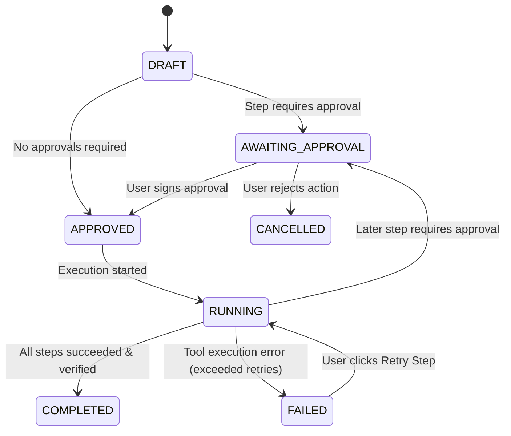

# ContextPilot AI — Agent Planning & Orchestration Engine

## 1. Intent Detection & Decomposition
When an objective is received, the agent determines whether the input is:
- **General conversational inquiry**: Responds directly with synthesized reasoning.
- **Grounded query**: Queries the knowledge base and cites exact excerpts.
- **Workflow / Task plan**: Triggers the structured planner to formulate ordered steps.

## 2. Structured Task Plan Schema
Each task is generated with strict validation against registered tool contracts:

```json
{
  "objective": "Analyze quarterly cloud spend and export financial audit report",
  "description": "Calculates AWS and infrastructure costs with safe math and exports a sensitive audit report.",
  "risk_level": "HIGH",
  "estimated_complexity": "COMPLEX",
  "steps": [
    {
      "step_order": 1,
      "description": "Compute statistical metrics across cloud services",
      "tool_name": "data_analysis",
      "tool_input": { ... },
      "expected_output": "Summary metrics",
      "risk_level": "LOW",
      "requires_approval": false
    },
    {
      "step_order": 2,
      "description": "Compute reserve margin with safe calculator",
      "tool_name": "safe_calculator",
      "tool_input": { "expression": "..." },
      "expected_output": "Projected budget figure",
      "risk_level": "LOW",
      "requires_approval": false
    },
    {
      "step_order": 3,
      "description": "Generate external financial executive audit report in JSON",
      "tool_name": "export_tool",
      "tool_input": { "format": "json" },
      "expected_output": "JSON file artifact",
      "risk_level": "HIGH",
      "requires_approval": true
    }
  ]
}
```

## 3. Human Approval Gate State Machine



## 4. Controlled Tool Dispatcher
- **Zero Arbitrary Execution**: Tools cannot run arbitrary shell commands or dynamic python strings.
- **Payload Sanitization**: Passwords, tokens, and authorization keys are automatically redacted.
- **Outcome Verification**: The task is only marked `COMPLETED` when the actual tool execution records confirm success.
