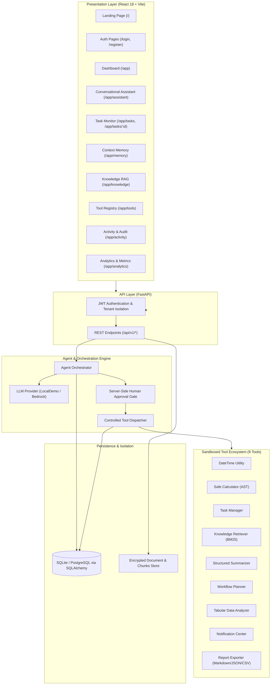

# ContextPilot AI — System Architecture

ContextPilot AI is architected as a modular, high-fidelity agentic AI platform designed for the Amazon Developer Hackathon. It bridges natural-language intent with reliable, approval-gated tool execution.

## High-Level Architectural Diagram

## Architectural Pillars

1. **Strict Server-Side Safety Gate**:
   - Agent models cannot unilaterally execute consequential operations. If a step is marked `requires_approval=True` or has `risk_level == "HIGH"`, the backend halts pipeline execution and persists an `ApprovalRequest`.
   - The pipeline remains in `AWAITING_APPROVAL` status until a signed human approval payload is received.

2. **Per-User Tenant Isolation**:
   - All database tables enforce foreign-key ownership by `user_id`. Queries filter explicitly by authenticated identity derived from the verified JWT access token.
   - Cross-user data leakage is strictly blocked.

3. **Multi-Provider LLM Abstraction**:
   - `BaseLLMProvider` decouples the system from proprietary APIs.
   - `LocalDemoProvider`: Deterministic, rich offline execution engine requiring zero cloud credentials or paid tokens.
   - `BedrockProvider`: Genuine Amazon Bedrock Converse API adapter supporting Claude 3 Sonnet and Amazon Titan.

4. **Verifiable Execution Outcomes**:
   - The orchestrator verifies task completion based strictly on actual tool outputs returned from the sandboxed dispatchers rather than model hallucination.
