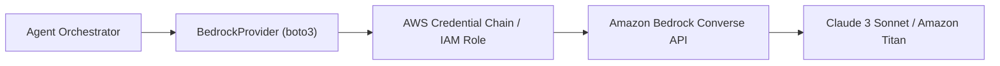

# ContextPilot AI — AWS Bedrock & Cloud Integration

## 1. AWS Architecture Overview
ContextPilot AI is designed for seamless integration with **Amazon Bedrock** for enterprise-grade foundational model reasoning, while maintaining an offline local demo mode.



## 2. Configuration & Credentials
To connect genuine AWS services, set the following environment variables in `.env` or your host environment:

```env
LLM_PROVIDER=bedrock
AWS_REGION=us-east-1
AWS_ACCESS_KEY_ID=your_access_key_id
AWS_SECRET_ACCESS_KEY=your_secret_access_key
BEDROCK_MODEL_ID=anthropic.claude-3-sonnet-20240229-v1:0
```

### Supported Models
- `anthropic.claude-3-sonnet-20240229-v1:0`
- `anthropic.claude-3-haiku-20240307-v1:0`
- `amazon.titan-text-express-v1`

## 3. Required IAM Permissions
The calling IAM user or role requires the following minimum policy:

```json
{
  "Version": "2012-10-17",
  "Statement": [
    {
      "Effect": "Allow",
      "Action": [
        "bedrock:InvokeModel",
        "bedrock:Converse",
        "bedrock:ListFoundationModels"
      ],
      "Resource": "*"
    }
  ]
}
```

## 4. Diagnostics & Fallback Strategy
- The application provides a live connection test button in **Settings → Integrations & AWS**.
- If AWS credentials are absent or return `NoCredentialsError`, `AccessDeniedException`, or `ResourceNotFoundException`, the application surfaces a human-readable diagnostic message and defaults gracefully to the **Deterministic Local Demo Engine**.
